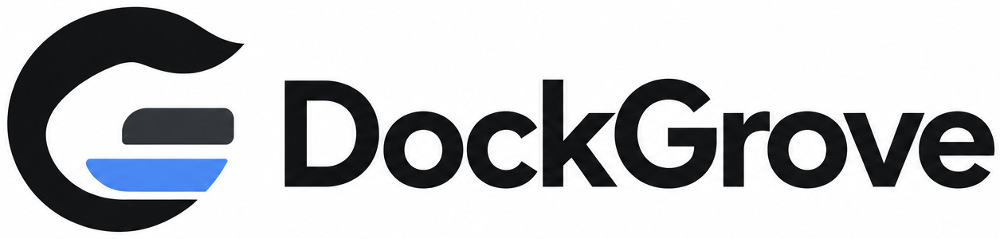

# DockGrove



**Your apps, useful widgets, and AI usage in one native Mac Dock.**

DockGrove is a native Mac app. It gives you a customizable glass Dock with app launchers, a widget library, saved layouts, and a tile for the usage limits returned by your ChatGPT account's Codex service.

Built with Swift, SwiftUI, and AppKit. The 1.0 commercial candidate adds purchase and activation services while keeping notes, tasks, recordings and companion progress local.

> **Native in-app purchases:** the Xcode app now offers **Plus at US $4.99 once** for everyday widgets and **Full Access at US $9.99 once** for all widgets, companions, GitHub, and AI usage. Basic Dock functions remain free. See [native purchases](docs/IN-APP-PURCHASES.md) for the exact split, StoreKit testing, and remaining App Store setup. These products are not live yet. The separate website Stripe candidate remains test-only; see [commerce setup](docs/COMMERCE.md). The legacy 0.8 edition retains its MIT permissions. DockGrove is independent and not affiliated with Apple, CoolDock or OpenAI.

[DockGrove website](https://dockgrove.com/) · Website source and the test-commerce implementation are under `website/`. Checkout remains unavailable until the test services are configured.

Compatible Macs can enable **Notch quick access** in Settings → Appearance. The resting notch matches the system camera housing. Hover or click to open a short horizontal strip. Home contains controls and searchable widgets; the second Files tab holds the file tray. Scroll sideways within either tab to explore. Appearance settings control the notch width, and Files has separate Tray and AirDrop drop zones. See [notch behavior and validation](docs/NOTCH.md).

Toolbar dimensions are available in Settings → Appearance → Toolbar size. Drag a number badge left or right, or use its −/+ buttons, to adjust width, height, and icon size. Compact, Balanced, and Spacious previews apply presets; Fit width to content chooses between a content-sized bar and your chosen width. Changes save automatically and support Undo layout. Widget and display choices expand into searchable inline panels, and on/off settings use switches.

## Repository layout

- [`app/`](app/) contains the native macOS app, assets, build scripts, tests, and Xcode project.
- [`website/`](website/) contains the website, commerce backend, and web tests.
- [`docs/`](docs/) contains shared product and release documentation.

Open `app/DockGrove.xcodeproj` in Xcode and select **DockGrove StoreKit Testing** to build and try local test purchases without charges. The **DockGrove** scheme uses the real StoreKit environment; products require App Store Connect setup. The checked-in project can be regenerated from `app/project.yml` with `cd app && xcodegen generate`.

## Companion and personalization

Nine distinct SpriteKit pixel-art companions use shared GPU textures and complete-body frames, eased walking and turning, gentle idle blinks, settling and sleeping. The dragon flies. All sixteen poses per animal are checked for transparent margins and consistent scale. Care and focus progress remain local. Drag any app or widget onto another tile to take its position; apps, widgets, clock and usage tiles share one saved order. A colored border marks the drop target. Keep holding over a page arrow for just over half a second to turn the page; keep holding to continue through pages, then move onto a tile and release. Dropping directly on an arrow is a shortcut to move to the adjacent page. Releasing elsewhere outside the tiles cancels the move. Grab the small accent-colored handle at the top of a Dock to move it; replacement docks remain at the bottom while companion docks can float. Themes and arbitrary accent colors are independent for each Dock under Settings.

## Requirements

- macOS 14 Sonoma or newer.
- Apple Silicon or Intel Mac. The build produces a universal app.
- Xcode Command Line Tools to build from source (`xcode-select --install`).
- A compatible Codex CLI signed in with ChatGPT for Codex allowances. API/team usage widgets require their own provider admin keys; other widgets work without these connections.

## Install

### Download a build

The 1.0 candidate is not yet a public commercial release. Development CI artifacts are for review, not paid fulfillment. A configured commercial build will activate with a test license issued by the test backend; its private release artifact is served only through the license-checked download endpoint.

Do not replace an installed working Dock during review. The development build uses a separate bundle identity. Legacy public downloads remain historical artifacts with their original license.

Builds are ad-hoc signed for local testing, **not Developer ID signed or notarized by Apple**. If macOS blocks a build you trust, use its **System Settings → Privacy & Security → Open Anyway** flow. Do not disable Gatekeeper globally.

### Build from source

```sh
git clone https://github.com/dylanlasensky/DockGrove.git
cd DockGrove/app
xcodebuild -project DockGrove.xcodeproj -scheme DockGrove -configuration Development -derivedDataPath .build/xcode build
# Open the development build only when ready to review:
open .build/xcode/Build/Products/Development/DockGrove.app
```

The **Development** configuration builds a universal, ad-hoc-signed app with a separate development bundle identifier. The **Commercial** configuration (scheme **DockGrove Commercial**) enforces activation; first run `swift Scripts/ValidateLicenseConfig.swift`, then pass only the public license-server URL, verification public key and key ID as build settings (`DOCKGROVE_LICENSE_SERVER_URL`, `DOCKGROVE_LICENSE_PUBLIC_KEY`, `DOCKGROVE_LICENSE_KEY_ID`) — see [commerce setup](docs/COMMERCE.md). **CommercialQA** builds the locked state under its own bundle identifier. An unconfigured commercial build fails closed. It packages the exact owner-supplied icon into standard macOS icon sizes. Build outputs are excluded from version control. Ad-hoc rebuilds may require you to re-enable macOS privacy permissions; stable distribution requires a consistent Developer ID signature.

## First setup

1. Open Settings from the DockGrove icon in your menu bar or the sliders button in DockGrove.
2. In **Library**, browse visual widget previews or switch to **Apps**. Drag a card into **Your Dock** or directly onto the actual DockGrove bar. Drop on the left or right half of a tile to choose its position. Existing items move without duplicating.
3. Use the preview’s left/right arrows and page counter to browse the whole layout. Drag tiles to reorder them, drop onto **Drop to remove**, or right-click for move/remove commands. **Undo layout** restores recent edits. Changes save immediately; widget preview content is illustrative.
4. In **Appearance → Widget shapes**, choose a widget and select Card, Square, Circle, or Pill. You can mix shapes in one Dock; compact shapes open the complete widget controls when clicked. Shapes travel with dragged widgets, save with named layouts, and support Undo layout. Choose a theme preview in **Appearance**, then adjust icon size, accent, rich cards, width, and position. Browse **16 color packs and 92 accents**, grouped into Essentials, Nature, Soft, Vivid, Earth, and Seasonal collections. Pack cards preview their swatches; select a pack, then choose its accent. New packs include light/dark variants. New installations follow the Mac’s appearance; existing themes are preserved.
5. In **Behavior**, choose a display, automatic hiding, hide-on-overlap, clock, and window snapping. Enable **Use DockGrove as my Dock** for replacement mode. Your original Apple Dock preferences return when you turn replacement off or quit.
6. Save or import named layouts under **Behavior**, and manage extra docks from the sidebar. App paths must exist on the destination Mac.
7. **Purchases** contains the one-time Plus and Full Access offers and Restore Purchases. Locked library cards show their required tier and open these offers when clicked.

The DockGrove menu-bar icon always gives access to Settings, show/hide, usage refresh, Apple Dock restoration, and Quit. **Done** closes Settings. ⌘W closes Settings and ⌘Q quits while DockGrove is active.

## Features

| Feature | Available now |
| --- | --- |
| Native glass Dock | Bottom replacement; top/bottom companion mode; selected display; full-screen/session/sleep suppression; true auto-hide; optional hide-on-overlap; icon sizes, accents, whole-card pages |
| App management | Searchable Add/Replace picker, position-preserving replacement, Undo, pinned/running apps, running indicators, drag reorder and contextual actions |
| App search | Installed-app discovery, filtering and location disambiguation; refresh for installed, moved or removed apps |
| Saved layouts | Save/apply/remove layouts; JSON export and import |
| ChatGPT plan usage | Actual returned Codex allowance buckets, percentages remaining, reset times, manual or five-minute refresh |
| Focus timer | 5, 15, 25, and 50 minute presets; pause, resume, reset, completion sound |
| Quick note | Editable note saved automatically on this Mac |
| Tasks | Local tasks, completion toggles, individual removal, clear completed |
| File shelf | Add files and folders, drop file shortcuts, drag out, open, reveal, and open Downloads |
| System information | Live CPU sparkline, active/wired/compressed memory use, network throughput, battery/charging state, installed RAM and available disk space |
| Calendar | Opt-in access to the next seven days of Mac calendar events; manual refresh |
| Clipboard | Opt-in text history, up to 20 entries in memory, click to copy, clear history |
| Weather | Apple WeatherKit current conditions, feels-like temperature, and manual city search |
| GitHub | Public repositories or existing `gh` sign-in; stars/forks, open issues and PRs, latest Actions run, optional five-minute refresh, stale/error states |
| Bookmarks | Local named HTTP/HTTPS links; add, open, remove |
| Folders & Downloads | Choose a folder, navigate up/into subfolders, search, sort by name or newest, open, reveal, drag files out |
| Stopwatch | Start, pause/resume, laps, reset |
| Drink water | Personal daily goal, count, midnight reset, optional hourly sound while running |
| Habits | Daily completion toggles and up to 366 recorded completion dates per habit |
| Time progress | Day, month and year progress in your local calendar |
| World clocks | Add/remove IANA time zones, including daylight-saving handling |
| Converter | Offline length, mass, temperature, decimal/binary data conversions |
| Screenshot | Interactive region capture to clipboard; macOS screenshot/recording toolbar |
| Color picker | Native screen sampler; copy hex color |
| Quick controls | Mission Control, Emoji & Symbols, Trash, sound/display/network settings shortcuts |
| Apple Reminders | Explicit opt-in connection, read incomplete reminders, mark selected reminders complete |
| Widget organization | Search library, move widgets earlier/later, remove by right-click, space and separator entries |
| Login startup | Native macOS login item registration; approval status shown |
| Music | Opt-in Spotify or Apple Music connection, track/artist, previous/play-pause/next, ten-second polling while connected |

## New in 0.7

- **Multiple docks:** Settings → Manage all docks adds up to three extra docks. Each has its own apps, widgets, paging, display, position and appearance. Only the main dock replaces Apple's Dock. Extra layouts can sit at the top, bottom, or a floating position. Width never clips a whole widget; page arrows keep everything reachable. Display choices retain a physical display identifier and fall back safely if disconnected.
- **Window snapping:** Enable it in the main Dock's Settings, grant macOS Accessibility, then hold Option while dragging a title bar. Pause briefly at an edge for the preview and release. Sides create halves, corners create quarters, top maximizes, and the bottom edge uses the bottom half. Escape cancels; Windows → Undo layout restores the original frame. Requiring Option is configurable. Other apps' minimum sizes still apply. This is not native macOS workspace reservation.
- **Appearance:** Glass, Graphite, Pearl and System themes; independent dock widths, horizontal alignment and floating height; arbitrary accents; appearance saved with layout profiles. Reduce Transparency and Reduce Motion are respected.
- **Music:** Spotify artwork and local Apple Music artwork, with an optional subdued background sampled from the album. A neutral fallback keeps transport usable when art is unavailable. Spotify artwork requests go to its image CDN; images are bounded, downsampled and held in memory.
- **Companion cat:** Enable Companion cat, name your cat, feed, play or rest. Completed DockGrove focus sessions grant joy and levels. Needs do not decay for time spent away; no application or keystroke tracking is used.

The website candidate lives in [`website/`](website/), with a separate test-commerce Worker configuration. The [public website](https://dockgrove.com/) presents the candidate with checkout unavailable until configured. Read [website setup](website/README.md) before testing; live sales require separate owner configuration and approval.

## New in 0.6

- Claude Code allowance windows through its supported local status-line interface.
- Gemini CLI session tokens and requests by model, imported locally without retaining prompts or responses.
- A new static website with original DockGrove branding, scroll storytelling, interactive product demos, and reduced-motion support.
- Separate free Cloudflare preview hosting with a direct universal-app download.

See [AI connection instructions](docs/AI-CONNECTIONS.md) for setup, privacy, and provider limitations.

## New in 0.5

- **A coherent identity:** an original monochrome DockGrove mark, a redesigned app icon, quiet typography, translucent surfaces, rounded widget cards and consistent spacing. Native SF Symbols remain familiar; DockGrove does not use Apple's logo or imply Apple affiliation.
- **Useful at a glance:** timers, task lists, calendar agendas, music, system graphs, water progress and AI reports now show their actual content directly on the Dock. Focus, stopwatch, water and connected music have inline controls. Compact tiles remain available.
- **Any accent:** choose White or None for a neutral workspace, a curated color, or the macOS color picker for a custom RGB color. Custom colors persist and travel with layout exports.
- **Window resizing:** waits for asynchronous app layout, retries size/position changes, and temporarily restores standard resize behavior for apps with enhanced accessibility UI. The operation runs off the UI thread. Success means the actual frame matched; genuine minimum-size restrictions still produce an explanation and preserve Undo.
- **Calculator:** offline arithmetic with parentheses, powers, percentages and explicit invalid-expression/division-by-zero errors.
- **Currency:** daily reference rates for 15 currencies, swap direction, editable amount and rate date. Refresh sends only the selected currency pair to [Frankfurter](https://frankfurter.dev/); amounts remain local. These are reference rates, not transaction quotes.
- **Voice memos:** explicit microphone permission, record, pause/resume, stop/save, playback inside DockGrove, export and Finder reveal. Audio stays in `~/Library/Application Support/DockGrove/Voice Memos`; quitting stops recording. Nothing is uploaded.
- **Audio:** select an output device and adjust system output volume where the device supports it. External devices with fixed volume expose a clear explanation.
- **App groups:** create named collections of pinned apps, launch from a compact grid, and remove groups without touching installed apps.
- **Web search:** query DuckDuckGo, Google or Bing in your browser.

## Connected widgets and Dock behavior

- Whole-tile Dock pages prevent right-edge overflow. Previous/next controls, page count and Settings stay visible, including with all widgets enabled.
- **Windows**: move a selected window to halves, quarters, maximize or center, choose a display, focus, minimize and undo. Allow DockGrove in Privacy & Security → Accessibility, then Refresh windows. Native full-screen windows must leave full screen first. Apps may enforce their own minimum sizes; DockGrove reports constraints and preserves Undo. Option-drag edge snapping is also available; window thumbnails are not implemented.
- **Google Calendar**: add Google in macOS Internet Accounts, enable Calendars, then connect the widget and select calendars belonging to that account. DockGrove reads the next seven days through EventKit; macOS owns Google sign-in and synchronization. The general Calendar widget can include iCloud, Google and other configured calendars. Both refresh while connected and support Disconnect. No custom Google OAuth client is needed.
- **Spotify and Apple Music**: separate widgets can be enabled together. Open the installed player, then Connect / refresh and allow Automation. Track, artist, playback state and transport controls refresh every ten seconds while connected. Reads run off the UI thread with a timeout; an exited player or failed read clears stale track data. The original Music widget remains as a combined panel.
- **OpenAI API, Claude API and Cursor team usage**: enable each from the widget library, enter that provider's organization/team admin API key in its secure field, and press Save & connect. Keys are stored in macOS Keychain. Refresh is explicit, with optional hourly polling for the current session. Disconnect & forget removes the saved key. Reports cover the last seven days; API widgets show tokens and Cursor shows separate activity counts. These require admin access and do not show ChatGPT Plus, Claude Pro/Max or personal Cursor subscription allowances. No API inference is performed.

API references: [OpenAI organization usage](https://developers.openai.com/api/reference/resources/admin/subresources/organization/subresources/usage/methods/completions), [Claude usage reports](https://platform.claude.com/docs/en/manage-claude/usage-cost-api), [Cursor team analytics](https://cursor.com/docs/account/teams/admin-api). Calendar setup: [Apple's calendar account guide](https://support.apple.com/guide/calendar/add-calendars-and-calendar-accounts-icl4308d6701/mac).

## Connect Codex allowance usage

1. Sign in with **ChatGPT** in Codex.
2. In DockGrove Settings, choose **Connect & refresh**.
3. If the executable is not detected, select it with **Choose…**. Common locations include `/opt/homebrew/bin/codex`, `/usr/local/bin/codex`, and the Codex CLI bundled with the ChatGPT desktop app.
4. Enable **Refresh usage automatically** if desired. Clicking the usage tile shows allowance details and reset times.

DockGrove calls the documented local `account/rateLimits/read` app-server method. It does not send prompts, run inference, redeem reset credits, scrape your chats, copy browser cookies, or parse credential files. Codex owns authentication and contacts OpenAI to retrieve your account's limits.

**This is not a general ChatGPT message counter.** It displays the allowance buckets the Codex service exposes for your account. Regular chat message quotas may not be included. API-key-only accounts may not expose subscription usage. Missing data is shown as unavailable; a failed refresh keeps a clearly marked previous reading.

Protocol reference: [OpenAI Codex App Server](https://developers.openai.com/codex/app-server/).

## GitHub widget

Enable **GitHub** in the widget library. Enter `owner/repository` or a GitHub repository URL, then press **Refresh GitHub**. Public access uses GitHub’s public REST API and needs no sign-in. For private repositories, install GitHub CLI, sign in yourself using `gh auth login`, and select **Use existing GitHub CLI sign-in**. DockGrove only runs `gh api --hostname github.com --method GET`; it does not request tokens or edit repositories. CLI errors are shown without printing potentially sensitive stderr.

Latest build status distinguishes queued/running/completed states. A failed refresh keeps a visibly marked previous reading. Switching repositories or access modes clears the previous repository and ignores responses from old requests. Actions or issues that are unavailable do not erase otherwise available repository metadata. This widget supports github.com, not GitHub Enterprise hosts yet.

## Permissions and data

- **Microphone:** requested only from Record new memo. Recordings remain local until you explicitly export them.
- **Currency:** sends only a currency pair to Frankfurter when refreshed.
- **Web search:** sends the typed query to the chosen search engine when you press Search.
- **Reminders:** requested only from Connect / refresh Reminders. Completing a reminder writes that selected change to Apple Reminders.
- **Screen capture / color:** invoked only by their buttons; macOS handles any required permission. Screenshot capture goes to the clipboard; the toolbar can choose a save location.
- **GitHub:** sends the repository name to GitHub when refreshed. Optional CLI mode uses the account already signed in to `gh`. No DockGrove credential store.
- **Window management:** opt-in Accessibility access permits reading window titles and moving/resizing selected windows. Titles remain in memory.
- **AI API widgets:** explicitly saved admin keys reside in Keychain and are sent only to the provider API. Reports stay in memory. Credentials are never exported with profiles.
- **Calendar:** requested only when you press Connect / refresh calendar. Events are read into memory; DockGrove does not edit them.
- **Music:** macOS asks for Automation permission for your chosen player. Open Spotify or Music and play a track before connecting. Disconnect stops polling.
- **Clipboard:** disabled on every launch until explicitly enabled. Text history stays in memory and clears when you quit. Copies marked concealed, transient, or automatically generated are skipped. Apps do not all mark sensitive text, so disable capture when copying sensitive information.
- **Weather:** city search uses Apple geocoding, then WeatherKit’s native Swift API for current conditions. Requests happen only when you refresh; the device’s location is not requested. Apple Weather attribution and data-source links appear with the results. Live access requires WeatherKit-enabled signing; see [WeatherKit setup](docs/WEATHERKIT.md).
- **Notes, tasks, shelf paths, layouts, preferences:** stored locally in DockGrove's macOS preferences. Layout exports contain app paths and appearance settings, not notes, tasks, credentials, or clipboard history.
- **File shelf:** stores shortcuts to originals. Removing a shelf item does not delete the file. Moved/deleted original files need to be re-added.
- **Telemetry:** no DockGrove analytics or tracking server.

## Apple Dock restoration

Replacement mode journals the original `autohide` and `autohide-delay` preferences before making changes, including whether each key was absent. It sets auto-hide and a long reveal delay so Apple’s Dock does not compete with DockGrove at the bottom edge. It does not patch macOS or remove Dock icons. A brief desktop flash occurs when the native Dock restarts.

Quitting or choosing Restore Apple Dock restores the exact journaled values. Relaunch recovers an interrupted session before reapplying the saved replacement choice. If DockGrove crashes, preferences remain changed until recovery; the menu-bar Restore action and this command are available:

```sh
/path/to/DockGrove.app/Contents/MacOS/DockGrove --restore-dock
```

Quit a running DockGrove before using command-line recovery. If necessary, change auto-hide directly in System Settings → Desktop & Dock. Restoration failures retain the journal for retry. A second normal DockGrove instance cannot take ownership of the first instance’s Dock settings.

DockGrove excludes native full-screen Spaces and suppresses its panel when the active regular app covers the selected display, during session inactivity, and while displays sleep. Hidden means no visible panel and no interception of clicks. A quarter-second edge dwell reveals an auto-hidden Dock; it hides 0.7 seconds after leaving. Full-screen suppression takes precedence over popovers. Background utilities’ transparent overlays are excluded from full-screen detection. Window-bounds detection is conservative; unusual games/video players and more display configurations still need hardware validation.

## Tests

Run these commands from `app/`:

```sh
xcodebuild test -project DockGrove.xcodeproj -scheme "DockGrove Tests" -configuration Development -derivedDataPath .build/xcode
```

All testing runs through Xcode (⌘U on the **DockGrove Tests** scheme, or `xcodebuild test`). The `DockGroveTests` XCTest bundle runs inside the app and collects code coverage. Native view and window-state checks are a UI test: run the **DockGrove Native Tests** scheme on a logged-in desktop. Live GitHub, Codex, currency, system, audio and Apple Weather checks are skipped unless you opt in with `TEST_RUNNER_DOCKGROVE_LIVE_TESTS=1 xcodebuild test …` (optionally `TEST_RUNNER_DOCKGROVE_WEATHER_CITY`). Live service checks are explicitly separate from offline regression tests.

The Swift `CodexFixture` tool runs locally without credentials or network calls. It checks the actual subprocess handshake, notification handling, and split response framing. Decoder tests cover multiple usage buckets, legacy fallback, missing windows, percentage bounds, and persistence formats for layouts and tasks. Regression tests also cover Dock visibility timing, negative display coordinates, durable preference restoration and failure retries, local utility persistence, stopwatch timing, folder search, bookmark validation, unit conversions, and GitHub response states. GitHub Actions runs two independent universal builds and offline test jobs on pushes and pull requests. See [validation details](docs/VALIDATION.md).

## Current limitations and roadmap

This is a substantial early-access app, not a complete CoolDock clone. In particular:

- Up to four independent docks, each selecting a display. Left/right vertical layout and automatic profile switching are not implemented.
- Connected calendars refresh every minute and on Calendar changes. Weather refreshes manually and currently uses the first matching city and Fahrenheit.
- Tasks are DockGrove-local; Apple Reminders is a separate opt-in widget. Focus sessions and stopwatch laps do not survive quitting the app.
- System monitoring samples while enabled; CPU history is limited to the current session. Hardware temperature and peripheral battery telemetry are not implemented.
- No native minimized-window tiles, arbitrary third-party notification badges, Handoff, or system-wide workspace reservation. Public-API window controls and document drops improve everyday use but do not provide full native Dock parity.
- No automatic update service, Apple notarization, or App Store distribution yet. Login startup needs an installed app and may require macOS approval.
- Codex allowances, supported Claude Code allowance windows, Gemini CLI session tokens, GitHub, OpenAI/Claude API usage, and Cursor team analytics are supported. Gemini consumer-chat quotas, ordinary ChatGPT message counts, and mail integrations remain unimplemented. Commerce is a local/test candidate and has not been validated with live provider credentials. API metrics and session tokens do not represent consumer-plan limits.
- Screenshots, unit/currency conversion, color picking, voice memos and app groups are supported. Wallpaper services, per-app audio mixing and window thumbnails remain unimplemented.
- Music and calendar need end-to-end validation across OS versions and real permission states. Multi-display placement needs testing on more hardware.

See [CoolDock comparison](docs/COOLDOCK-COMPARISON.md) for the sourced gap audit. Next priorities are window previews, additional supported providers, and multi-display hardware coverage. Production readiness requires broader testing and a signed/notarized release process.

## Project structure

```text
app/Sources/App.swift        App lifecycle, windows, placement, auto-hide, menu
app/Sources/DockBehavior.swift Visibility policy and transactional Apple Dock recovery
app/Sources/Utilities.swift   Local utility models and native system integrations
app/Sources/UtilityViews.swift Local utility popovers
app/Sources/GitHubWidget.swift Read-only GitHub REST and CLI client
app/Sources/GitHubView.swift  GitHub connection and activity UI
app/Sources/BehaviorTests.swift Regression checks
app/Sources/NativeTests.swift Opt-in native rendering/window checks
app/Sources/Model.swift      Apps, layouts and settings
app/Sources/Usage.swift      Read-only Codex usage client and data models
app/Sources/Views.swift      Main Dock, app tiles, usage details, settings
app/Sources/Toolkit.swift    Widget state, persistence, timers, integrations
app/Sources/ToolViews.swift  Widget popovers and library settings
app/Sources/SelfTests.swift  Decoding and persistence-format checks
app/DockGroveTests/          XCTest suites (offline regressions, opt-in live checks)
app/DockGroveUITests/        Native rendering and window-state UI test
app/CodexFixture/            Offline app-server protocol fixture tool
app/SignInFixture/           Deterministic sign-in fixture tool
app/DockTestHost/            Full-screen AppKit test host
app/Scripts/MakeIcon.swift   Exact-logo macOS icon packaging
app/project.yml              XcodeGen source for the project, configurations and schemes
```

## Contributing

Issues and pull requests are welcome. For bugs, include macOS version, processor type, app version, reproduction steps, and expected behavior. Do not attach credentials, private calendar data, or clipboard contents. Keep optional permissions and integrations opt-in, and include checks appropriate to changed behavior.

## License and proposed commercial transition

The existing [MIT license](LICENSE) and required notices are preserved. Legacy copies retain their permissions. The 1.0 paid offer does not itself retroactively close the source or revoke MIT rights. Proposed commercial terms and the file/release boundary require owner approval before live sales; see [the transition document](docs/COMMERCIAL-LICENSE-TRANSITION.md). Apple, Spotify, OpenAI, and other product names belong to their respective owners.

Connection setup lives in **Settings → Connections**. Widget settings shortcuts open the relevant music, calendar, reminders, or usage integration. Provider apps and Internet Accounts handle sign-in; access switches and key setup remain in DockGrove Settings.
